<picture><source media="(prefers-color-scheme: dark)" srcset="assets/hero-dark.svg"></picture>

<picture><source media="(prefers-color-scheme: dark)" srcset="assets/about-dark.svg"></picture>

<picture><source media="(prefers-color-scheme: dark)" srcset="assets/stack-dark.svg"></picture>

<a href="https://github.com/HmnDev-Tech/shevery"><picture><source media="(prefers-color-scheme: dark)" srcset="assets/project-shevery-dark.svg"></picture></a>&nbsp;<a href="https://github.com/HmnDev-Tech/ShizuConfigs"><picture><source media="(prefers-color-scheme: dark)" srcset="assets/project-shizuconfigs-dark.svg"></picture></a>

<a href="https://github.com/HmnDev-Tech/BLE-Droid"><picture><source media="(prefers-color-scheme: dark)" srcset="assets/project-ble-droid-dark.svg"></picture></a>&nbsp;<a href="https://github.com/HmnDev-Tech/Overcast-Next"><picture><source media="(prefers-color-scheme: dark)" srcset="assets/project-overcast-next-dark.svg"></picture></a>

<picture><source media="(prefers-color-scheme: dark)" srcset="assets/stats-dark.svg"></picture>

<picture><source media="(prefers-color-scheme: dark)" srcset="assets/streak-dark.svg"></picture>

<picture><source media="(prefers-color-scheme: dark)" srcset="assets/wave-dark.svg"></picture>

<picture><source media="(prefers-color-scheme: dark)" srcset="assets/social-l-dark.svg"></picture><a href="https://t.me/hmndevtech"><picture><source media="(prefers-color-scheme: dark)" srcset="assets/social-1-dark.svg"></picture></a><picture><source media="(prefers-color-scheme: dark)" srcset="assets/social-r-dark.svg"></picture>

<a href="https://metawka.github.io/expressive-profile/?from=HmnDev-Tech"><picture><source media="(prefers-color-scheme: dark)" srcset="assets/credit-dark.svg"></picture></a>

